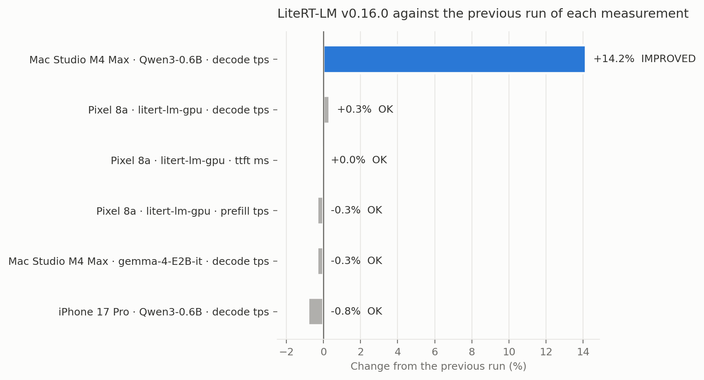

# edge-llm-bench

A neutral, reproducible benchmark harness for local LLM engines on real devices. It has stored runs for LiteRT-LM, llama.cpp, MLX, Apple Core AI, ExecuTorch and ONNX Runtime GenAI on a Mac Studio, iPhones, Android phones and a Windows laptop.



Use it to check whether a new engine release changed speed on your devices, or to measure a model and keep every raw log. The chart shows that check for LiteRT-LM v0.16.0: each bar compares one measurement with its previous run.

This repo publishes no rankings between runtimes. Every raw record is here, so you can build a leaderboard yourself with no device:

```bash
git clone https://github.com/john-rocky/edge-llm-bench && cd edge-llm-bench
python3 scripts/build_summary.py && python3 scripts/render_leaderboard.py
# -> LEADERBOARD.md (local, gitignored)
```

## Setup

You can read the records without any setup. To measure, start with `./bench doctor`, which says what is missing and how to fix it.

| Device | First time | Guide |
|---|---|---|
| Mac | about 45 minutes | [docs/setup.md](docs/setup.md) |
| Android | about 15 minutes with an authorized device | [`android/README.md`](android/README.md) |
| iPhone | half a day, with Xcode signing | [`docs/OPERATIONS.md`](docs/OPERATIONS.md) |
| Windows, over SSH | about an hour, mostly building LiteRT-LM | [`windows/README.md`](windows/README.md) |

## Measure a new release

A `.cells` file lists what to measure. Each line, called a cell, names a platform, an engine, a model and a task.

```bash
./bench release-watch        # upstream releases vs environment.lock.json
./bench matrix  matrices/apple-warm-matrix.cells
./bench regress matrices/release-regression-litert.cells \
    --engine litert-lm --version v0.16.0 --baseline engine:v0.15.0
```

Adding a model takes one more line. For example, this one measures LFM2.5-1.2B on an Android phone's GPU:

```
android litert-lm litert-community/LFM2.5-1.2B-Instruct short-chat backend=gpu file=LFM2.5-1.2B-Instruct_int4_gpu.litertlm
```

Every run writes a JSON record and its raw console log under `results/raw/<campaign>/`. The operating manual is [`docs/OPERATIONS.md`](docs/OPERATIONS.md), and [`skills/`](skills/) has playbooks for coding agents.

## Quickstart: the Android cells on a DDP lab phone

If you have no phone of your own, this route runs the Android cells on a phone in Google's Developer Device Platform (DDP), with no adb. You need gcloud signed in, a Cloud project with the Device Run API enabled, a bucket in it you can read and write, and python3 >= 3.10 with `huggingface_hub`.

```bash
git clone https://github.com/john-rocky/edge-llm-bench && cd edge-llm-bench
TAG=$(python3 -c 'import json; print(json.load(open("android/engine-pins.json"))["android_pins"]["litert-lm"])')
mkdir -p android/bin
curl -fL https://github.com/john-rocky/edge-llm-bench/releases/download/android-litert-lm-$TAG/litert-lm-$TAG-android-arm64.tar.gz \
  | tar xz -C android/bin && mv android/bin/litert-lm-$TAG-android-arm64 android/bin/$TAG
./bench doctor --platform ddp
./android/ddp/selftest.py
```

`selftest.py` runs offline and costs nothing. The next command is billed to your project. It runs one job twice on `akita-35`, a Pixel 8a, and took 7 minutes on 2026-10-16:

```bash
./bench matrix matrices/ddp-first-run.cells --ddp akita-35 \
    --project <your project> --bucket gs://<your bucket>
```

The records land in `results/raw/<date>-ddp-akita-35-android/app-path-android/*.json`.

### Run the Android cells on a Developer Device Platform phone

The [full steps](docs/ddp-phone.md) include a dry run and what it costs.

## How the numbers are checked

- Every row names its quantization recipe and engine version.
- Trials that disagree too much come back UNRELIABLE instead of scored.
- A crash, an out-of-memory run or an unsupported configuration stays in the table with its reason.
- Devices drift between sessions, so each session measures an anchor first and changes are normalized through it.
- Two runs with different token budgets or modes are not scored against each other.

See the [full rules](methodology/fairness-rules.md) and [how records are kept](docs/background.md).

## Coverage

[docs/coverage.md](docs/coverage.md) lists which engine has been measured on which device, and why the others haven't. `results/summary/device-runs.csv` has every stored run.

## Endurance

`endurance-chat-30m` holds one conversation in one engine process for 30 minutes and records every turn: decode rate, KV occupancy, memory and thermal state. It runs on a Mac and a Galaxy S26, with LiteRT-LM only for now ([protocol](methodology/endurance.md)).

## Provenance

This harness was carved out of [apple-silicon-llm-bench](https://github.com/john-rocky/apple-silicon-llm-bench), which remains the archive of published tables and raw history back to 2026-05.

License: MIT.
